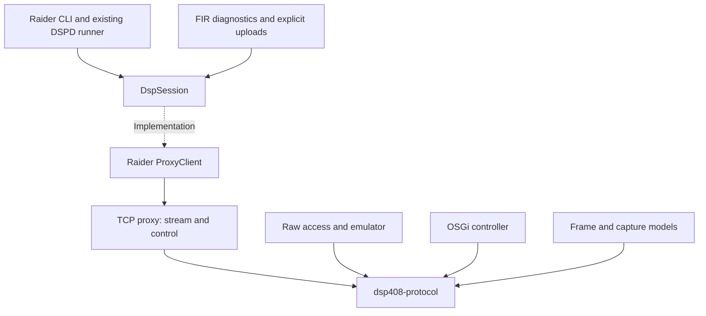
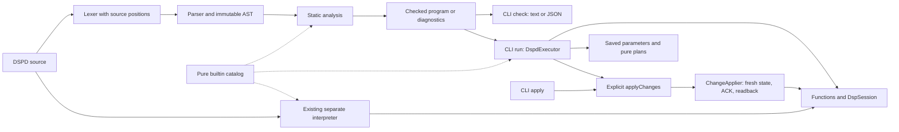

# DSP architecture

This repository-local overview also supports standalone Raider checkouts. The
optional multi-project workspace keeps its own shared architecture document.

[DSP Raider](../README.md) · [Documentation](README.md) ·
[Development](DEVELOPMENT.md)

Raider, the TCP proxy and the OSGi controller are independent applications.
They share wire framing while keeping their own transports, runtimes and
application models. Within Raider, offline analysis and planning are separate
from sessions and active device execution.

## Shared wire protocol

Arrows indicate usage. ProxyClient and the proxy communicate using the existing
TCP/JSON stream and control protocols; the device connection uses the binary
DSP protocol. The proxy can establish a device session without the original GUI.

[`dsp408-protocol`](https://github.com/DoctorRemoteControl/dsp408-protocol) is a plain Java 21 library and an
OSGi bundle. It contains no sockets, Jackson, CLI commands, device profiles or
runtime services.

- `DspFrameCodec`: encode/decode complete frames and read standard frames from
  an `InputStream`. Complete decoding remains available for raw experiments
  with headers that are not yet understood.
- `DspFrameDecoder`: incremental decoder per traffic direction, buffering at
  most 263 bytes. The length field determines stream boundaries; `10 03`
  inside the payload is no premature frame terminator.
- `DecodedFrame`: immutable data including checksum status. Strict readers
  reject bad checksums; the traffic logger retains them as invalid raw evidence
  and continues processing subsequent frames.
- `DspPayloads` and `Hex`: command/block identification and byte formatting.
  Application-specific model classes remain with the consumers.

Existing codec and utility entry points delegate to this library.

## Boundaries within Raider

| Area | Responsibility and boundary |
| --- | --- |
| `model` | immutable frames, responses, identities and capture values |
| `session` | `DspSession` contract and `DspSessionFactory` |
| `proxy` | TCP/JSON adapter for that contract |
| `dump` | profile-aware reads; reuse ready sessions |
| `snapshot` | validate wire data, analyze offline and compare completely |
| `parameters` | pure, firmware-specific gain/mute/delay codecs and evidence |
| `planning` | pure requests, quantization and immutable change previews |
| `capture`, `decode` | bounded passive capture and offline interpretation |
| `dspd` | lexer, AST, parser, static analysis and builtin catalog |
| `script` | checked AST execution, existing interpreter, values and function execution |
| `execution` | explicit parameter application, fresh-state checks, ACK/readback and partial results |
| `fir` | pure memory analysis, separate session diagnostics and test filter uploads |
| `tool`, `raw`, `emu` | application entry points, direct TCP adapters and emulator |

Lower layers do not call tool facades. Existing `ReadTool` and `WriteTool` entry
points remain available for Java callers. Sessions can be replaced through a
factory. Cleanup also runs after connection or script failures; close failures
remain attached to the original failure. `PackageDependenciesTest` checks for
package cycles.

### Snapshots, parameters and previews

The common CLI uses `ReadOnlySnapshotReader`. After the handshake, it identifies
the model, reads its block range and leaves a ready session intact. The older
reader and existing DSPD workflows retain their own behavior; their limits are
listed in the [CLI reference](CLI.md).

Snapshot files are validated against their wire bytes. JSON checksum flags do
not replace actual checksum validation. The diff retains all raw changes,
including missing blocks and trailing bytes; parameter changes and unmapped bit
changes are described before them.

The parameter model contains 36 channel definitions with separate read and write
evidence for **DSP408 V0104** and **FIR408 V0113P**. Unconfirmed, missing or invalid
values do not become confirmed parameter values. FIR mute is explicitly proven
only for InD and Out8. The controller continues to use its existing parameter
classes. Details: [Parameters](PARAMETERS.md).

Planning depends on neither device sessions nor transport. It compares encoded
target values, reports rounding and produces no payload when evidence is missing
or raw values are identical. `ChangeApplier` consumes the same planner through
an explicit active workflow: it rejects blocked requests, reads fresh state,
checks firmware and requested values, and validates each write by ACK and
full-snapshot readback. Partial results survive failure; there is no retry or
rollback. Existing raw writers keep their separate behavior.
Details: [Change preview](CHANGE-PREVIEW.md) and
[Execution](EXECUTION.md).

### Compiler, checked executor and existing interpreter

`check` creates no runtime and invokes no script functions. `run` compiles the
whole source before constructing its runtime; compilation failures prevent all
script effects, and runtime failures keep the actual source position and cause.
`CheckedDspScriptEngine` and `DspdExecutor` execute the checked AST without
reparsing statements. The session remains replaceable through `DspSessionFactory`.
The original separate interpreter remains an independent execution path without
an automatic compiler check. The four parameter functions described in
[DSPD syntax](../DSPD-SYNTAX.md#parameters-and-explicit-application)
are provided by the checked executor.

`run` may execute raw protocol functions as well as the explicit checked
parameter workflow. Only `apply` and `applyChanges` use `ChangeApplier`; a raw
`write` is not automatically routed through it. Firmware and requested values
bind an application to its baseline, but there is no verified unique physical
serial and snapshots are not atomic against other writers.
Diagnostics and limits: [DSPD check](DSPD-CHECK.md).

## Build, packaging and tests

The workspace POM aggregates the projects without becoming their Maven parent.
`de.drremote:dsp408-protocol:0.1.0-SNAPSHOT` is a versioned dependency; individual
builds require it in the local or organization repository first. The bundle
exports `de.drremote.dsp408.protocol`; controller core imports that package,
and the Karaf feature `dsp408-runtime` explicitly includes the bundle. Raider
and the proxy embed it in their executable shaded JARs.

`mvn -B -ntp verify` in the workspace builds and checks the twelve reactor
projects. Tests use saved/synthetic data and local test connections, without
operating the physical DSP. Hardware/GUI verification remains a separate
integration step. Build variants and targeted tests are documented in the
[development guide](DEVELOPMENT.md).

## Sources and repository boundaries

Protocol libraries, GUI page definitions, original DSPD scripts and captures
are retained evidence. Derived interpretations record firmware, source and
status rather than rewriting historical raw data. Independent Git histories
and local changes stay with their projects.
`PROJECTS.lock.json` in the multi-project workspace lists committed component revisions;
uncommitted development is not included.
